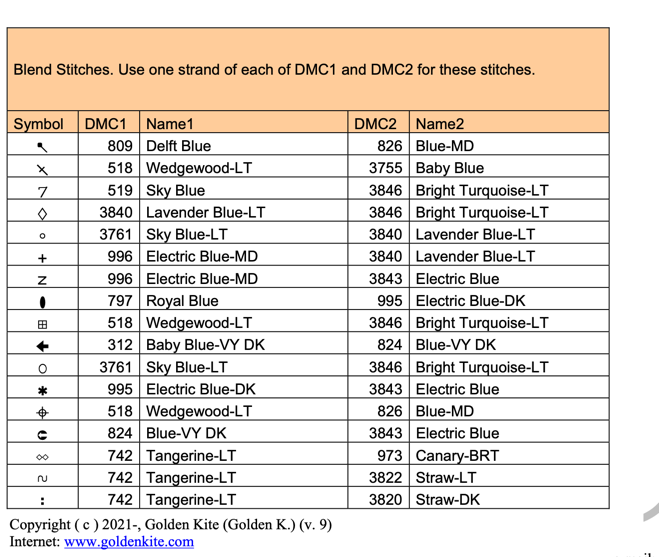

# пташечка — Backlog

> What is **not built yet**. What *is* built is in `SPEC.md`; where it lives in the code, in `ARCHITECTURE.md`.
> When an item is built: describe it in SPEC (its own §15.x), then remove it here.
> Reviewed against the code 2026-11-24 (`dev` after v2.3.1; B21 is built on the `offline-app` branch). Section numbers (§15.x) are SPEC's.

**Effort** (one person with the assistant, tests included): **XS** a few hours · **S** about a day · **M** 2–4 days ·
**L** 1–2 weeks · **XL** several weeks. **Files** says whether `.xbird` files or stored data change — anything there
follows RELEASING.md's compatibility rules (optional fields only, or ask first).

DONE 5) add group level visibility? we now have element level visibiliry (mute anyghint BUG), but what if people wanna see crossess only? 
DONE 10) lone crosses must have a super lone crosses mode !!
DONE 1) color picker doesn't always work correctly. something about the fact that i need to hover points directly at the item???

DONE 14) beads with floss in between the crossess. right now dont get read by app at all.  but only ONE of them. the other one got displayed just right .... wtf
 

DONE 9) proper landing!! - with a central button 'go to editor'
DONE 19) (built 2026-11-23 as our own counts instead of Vercel's paid custom events: SPEC §15.54 usage counts, §15.55 admin Stats page) треба збирати статистику про те, хто які кнопки нажимає та якими шорткатами користується! щоб переробити і те і те

DONE 14) + 1 feature : XSD import (SPEC §15.56; export stays out of scope). we are free to reverse engineer it. noone goona sue

DONE 12) fix the different 'new from' dialogs. now the behavior is inconsistent 

DONE 13) improve the expor to pdf :
DONE 14) the infrmation of the author and name of design should be on every page. also instructions must be exported
DONE 15) also improve the export to pdf for print. maybe add users the selection of what options they want??? add a preview of the resulting doc??? 

DONE 15) the 'replace in selection' dialog should have proper dropwowned that look the same as the original key 

DONE 12) treads and beads must alway display full catalogue of floss. existing floss can be duplicated. custom floss has just like an indicator . there is a quick filter 'only own' 
DONE 13) add 'similar' colors of the same brand AND translations to other brands. maybe come up with what usually is displayed there as well 

DONE 1) little bug. when i already have an entry of a solid color and i switch to blend : the one color must stay seelcted

12) user guides and probably an AI assistant that exaplains how to do one or another
11) FIX preview deploy on the vercel 

8) write to yulia after the speciality stitches are done!!!!

13) finish a proper local app installation. this will introduce a whole lot of problems later tho.

11) intoduce more icons. match with pattern maker. fix the export oxs so it displays the icons??? 
14) add fabricks!!! each fabric has a dmc code associated with it. so it's totally real 
13) follow up : introduce 'my stash'. then introduce my projects. where i can add my kits and it would help me specify if i got all the necesary supplyes or if i can use smth from my stash 

14) rework the floss and beads matching. using some existing trnalstion tables. 

10) billing options, ui, and backend. and frontend and FOP setup

bugs :
DONE 0) create proper app-specific email for emails DONE
DONE 2) picker doens't properly highlight the beads, but picks them. the same for other elements on the top layer
DONE 3) hide the delete and edit buttons from key unless hovered??? also add dublicate key
DONE 6) when i choose petite fractional stitch i cannot click and drag. it renders 1 cell = 1 petite. where it must be 1 cell = 2 petites . should not apply to 1/4 and 3/4 tho.
DONE 8) can your app read this? must open in the same tab
DONE 10) replace the email in all the docs. and remove my name new email is : ptashechka.app@gmail.com  old : bohdana.o.yurchenko@gmail.com
DONE 9) near symmetry ignores the backstitch!!!
DONE 13) eraser doesn't properly highlight the beads to be erased. eraser erases both bead and aligned cross in neighbour cell (use picker behaviour as reference)
DONE 16) duplicate button for custom flos!!! 
DONE 15) in icons popup the scroll panel hovers over the right most column. make it super thin
DONE 17) 'icon' for backstitch is actually compound. and it still cannot be identical. but the type alone can be identical. the combination of type and color = not 
DONE 20) треба шорткати для розміру пензля!! (D + 1, 2, 3, 4, 5???)??? 
DONE 21) шорткати мають працювати і для укр розкладки!!! 
DONE 18) make sure all the schortcuts work on windows AND the hints show the correct keys 
DONE 4) when i have a bead key on and move the mouse OFF the canvas and click - a bead gets placed in the edge of the canvas. the same probably with backstitch

## Overview, by effort

| # | Item | Effort | Files / stored data |
|---|---|---|---|
| B1 | **Bug**: Pattern Keeper doesn't read our blends | S | none |
| B2 | Finished size for several counts in the print PDF | S | none |
| B3 | Bead packs and units in the shopping list | S | none |
| B4 | Intended fabric: name and type | S | optional fields |
| B6 | Charm-shaped icons for Mill Hill Treasures | S | none |
| B7 | The installed app opens .xbird / .oxs files from the computer | S | none |
| B8 | More chart checks: backstitch, knots, beads, unused key entries | S–M | none |
| B9 | More sections on the account page | S–M | per section |
| B10 | SVG chart export | M | none |
| B12 | Autofill on colour-block charts (no symbols) | M | none |
| B13 | Brand tools: convert the key, discontinued DMC, … (equivalents in the colour panel: done) | M | none |
| B14 | Proofread tracking ("mark region as proofed") | M | optional field |
| B15 | Second-screen window | M | none |
| B16 | Keyboard data entry | M | none |
| B17 | Backstitch outline between colours, automatically | M | none |
| B18 | Text / alphabet tool | M | none |
| B19 | Read-only share links | M | new server table |
| B20 | Symbols from uploaded pictures | M | optional field |
| B21 | Opening without the internet — **built on `offline-app`, to merge** | M–L | none (browser cache) |
| B22 | PCStitch `.pat` import | M–L | none |
| B23 | Other apps' PDFs: part stitches, knots, beads; more apps | M–L | none |
| B24 | Floss usage rework; plastic canvas and wooden bases | L | optional settings |
| B25 | More thread brands (data; Dimensions done) | L | new brand ids |
| B26 | Specialty stitches: long stitch, lazy daisy, … | L | new optional layer |
| B27 | Stash management | XL | new server tables |
| B28 | `.saga` import (Cross Stitch Saga) | ? | none |

**Suggested order** (value for the effort): merge B21 (built) → B2, B3, B4 together (one "fabric & shopping"
release) → B1 (bug) → B10 (§15.27's ranking) → B8 → B24 → B27.

---

## XS / S

### B1. Bug: Pattern Keeper doesn't read our blends — S
**Found 2026-11-19** (checked in the app): in the PDF for Pattern Keeper (§15.10) the blend rows aren't recognised —
Pattern Keeper doesn't see the blends' threads. They can still be added by hand in Pattern Keeper, so the chart is
usable, but not "nothing has to be typed in".

**Today** (`src/core/formats/pdf/patternKeeper.ts`, the thread list): a blend is a row of the one Number · Name ·
Strands · Stitches table, its number cell "DMC 310 + DMC 321", name "Black + Christmas Red", strands "1+1".

**A layout Pattern Keeper reads correctly** (another designer's PDF, 2026-11-19): blends in a **separate table** after
the threads, with a heading line "Blend Stitches. Use one strand of each of DMC1 and DMC2 for these stitches." and
the columns **Symbol · DMC1 · Name1 · DMC2 · Name2** — one thread per column, numbers without the brand word,
right-aligned:

**Fix**
1. Take blends out of the thread table; after it, a blend table laid out as above (ruled like the thread table, the
   symbol on the blend's colour block in the first column; a Stitches column at the end if Pattern Keeper accepts it
   — try with and without).
2. Brand: the sample has DMC only, the brand in the header ("DMC1"). For a blend of other brands try "Anchor1" /
   the brand word in the cell; if Pattern Keeper can't read it, leave such blends out of the PK chart and list them in
   *About this chart* (as other untrackable stitches are).
3. Check in Pattern Keeper on a test pattern with 2–3 blends (thread + thread, two of the same brand); then update
   §15.10 ("Verified in Pattern Keeper") and the `patternKeeper.test.ts` expectations.

### B2. Finished size for several counts in the print PDF (§15.21) — S
The cover shows the size on the pattern's own count only (`chartPdf.ts`, the cover block).
- A small table: 11, 14, 16, 18, 20, 22 ct, and 28 and 32 over 2 — in cm and inches.
- Optionally the fabric to buy, with a margin (e.g. 8 cm / 3 in each side).
- Both languages. Goes well with B4 (the fabric's name on the cover).

### B3. Bead packs and units in the shopping list (§15.22) — S
Done already: the CSV writes "2 skeins" (`csv.unit.*`), and the calculator's line type has `pack` and `meter` units.
Still open (checked 2026-11-24 — nothing of it built yet):
- **Beads**: the calculator gives a count of beads (`unit: "bead"`). The catalogue knows each Mill Hill bead's
  package size (`ColorEntry.pack`, §2.2, Treasures included) → "2 packs (≈ 640 beads)". Preciosa has no pack (sold
  by weight) → the count stays. Own beads: a count, unless a pack size is added to the form.
- The PDF's **Materials** page (§15.10c) prints the same lines — it gets the packs too.
- **Totals panel**: each line shows "× 2" with the unit only in the heading — say "2 skeins" / "2 packs" on the line.
- After B24, metres as well.

### B4. Intended fabric: name and type (§15.19) — S
Today the pattern keeps a count (dropdown) and a colour (picker).
- A free-text **fabric name**, e.g. "Zweigart Aida 14 ct Antique White 101" or "Lugana 25 ct 3613" — next to the
  count in Fabric & size.
- Optionally a **type**: Aida / evenweave / linen / plastic canvas / wood (B24 uses it).
- Shown in the print PDF: on the cover with the finished size (B2) and in the key's header.
- Stored as optional fields (`fabricName`, `fabricType`) — no `.xbird` version bump; old files open as before.
- OXS: write the name only if the format has a field for it — check against the readers (Хрестики, Ruta Stitch).

### B6. Charm-shaped icons for Mill Hill Treasures (§15.24) — S
Treasures are drawn as a large round bead (radius 0.48). Charm shapes — heart, star, flower, leaf, … — per series
or per item, in the key, the chart and the PDFs. Needs a shape per Treasure (from the catalogue's names); vector
paths like the drawn symbols (§2.5).

### B7. Open .xbird / .oxs files from the computer in the installed app — S
Not built on any branch (checked 2026-11-24).
Undecided extra from §15.50: the manifest's `file_handlers` + `launchQueue` (Chrome / Edge), so double-clicking a
`.xbird` opens it in пташечка. The file then goes through the usual Open work file path (asks before replacing,
§15.25 / §15.43). Not in Safari. Small on its own; most useful together with B21.

### B8. More chart checks (§15.4) — S–M
Chart checks today: empty cells, lone stitches, near symmetry. Not checked:
- **Backstitch**: lines that end in the middle of nowhere close to another line (a gap of one cell), the same line
  twice, a line on top of another of a different colour.
- **Knots**: a knot exactly on top of another.
- **Beads**: a bead between cells next to a bead in a cell; beads on empty fabric inside a stitched area.
- **Key entries** used once or not at all (the key's counts show them already — maybe a finding is still handy).
Each is opt-in like the others; same results list, stepping and Ignore. Nothing stored.

### B9. More sections on the account page (§15.38) — S–M each
There is one section, **Account**. Possible ones:
- **Preferences** kept in the account (every device): language, theme, toolbar options, default fabric count and
  brands for a new pattern.
- **Profile picture** (S).
- Password — **not needed** while sign-in is Google or an email code; drop unless a password sign-in is added.

---

## M

### B10. SVG chart export (§15.27, ranked 2nd) — M
A vector chart, sharp at any size: the same drawing as the PNG chart images (colour / colour + symbols / symbols),
the symbols as paths (they exist for the PDF). Pattern ▾ › Export › Chart images. One file per view.

### B12. Autofill on colour-block charts — M
Autofill (§15.11) matches printed symbols. Charts without symbols (colour blocks) could use each cell's mean
colour: matched against the colour of the examples given for each key entry, with the same "sure / unsure" rule.

### B13. Brand tools (rest of §15.8) — M
Built: brands per pattern, DMC / Anchor / Madeira / Dimensions catalogues, Anchor's "≈ DMC …", own threads in any
brand, OXS brand prefixes (§15.28, §15.42); the Floss / Beads colour panel shows each colour in the other brands
(conversion chart, else nearest by CIEDE2000), lighter / darker and similar colours. Still open:
- **Convert key to brand…** — replaces every thread with its equivalent, keeps symbols and chart; a version is
  taken first (§15.7).
- **Show equivalents as**: none | DMC | Anchor | … — a second line in the key ("≈ DMC 310"): the official table
  first, else the nearest colour (ΔE76), labelled "≈ by colour".
- **Discontinued / renumbered DMC** codes with their replacements; flagged in the picker ("discontinued — use 3xxx").
- **Shopping list grouped by brand**, with skein length per brand.
- Picker search across all brands ("403" → hits in every brand, with a brand tag).

### B14. Proofread tracking — M
"Mark region as proofed" while checking a copy against the paper chart: select a region → proofed (a soft tint or
hatching, toggled like the ambiguous marks of §15.5); a count "1 240 of 9 800 cells proofed". Stored as an optional
field (like `amb`), so old files open as before. Discussed: not yet.

### B15. Second-screen window — M
The chart (or a photo) in a separate browser window on a second screen, following the main one. Live editing across
windows exists (§15.34) and could carry it; or a lighter view-only window via `BroadcastChannel`. Discussed: not yet.

### B16. Keyboard data entry — M
For copying charts fast: a cursor on the grid, type a key entry's symbol or shortcut to put a stitch and move on;
run-length entry ("12 × A"). Discussed: not yet.

### B17. Backstitch outline between colours — M
Draw backstitch along the borders of a colour area (or between all colours in a selection) automatically, in a
chosen thread. Idea offered 2026-11-14, not discussed further.

### B18. Text / alphabet tool — M
Type text and put it on the chart in a stitch alphabet (a few built-in sizes). Needs alphabets we may use (drawn
ourselves or openly licensed). Idea offered 2026-11-14.

### B19. Read-only share links — M
From §15.25 ("later"). A link that shows a pattern read-only, without an account. **Decide first**: the privacy
policy and the support page say today that the app can't publish or share patterns, and designers' copyright
matters — would need the policy rewritten, links that can be revoked, and probably only for one's own designs.

### B20. Symbols from uploaded pictures — M
Drawn symbols exist (§2.5). Uploaded ones: small pictures used as symbols on the chart, in the key and in the PDFs.
OXS has no way to carry them (falls back to a font symbol). Optional field in `.xbird`.

---

## M–L

### B21. Opening without the internet — installed app, phase 2 (§15.50) — M–L · **built, not merged**
Built on the **`offline-app`** branch (one commit, `51735bd`, SPEC §15.53 there): a service worker that saves every
page and file of the build ahead, a "new version — Reload" prompt, a start that doesn't wait for the sign-in check,
calm offline account pages. **Left**: merge into `dev` (it branched off before v2.2, so expect conflicts), check
offline in the installed app, release. Then remove this item.

### B22. PCStitch `.pat` import (§15.27, ranked 3rd) — M–L
Older and needs more reverse engineering than `.xsd` (KXStitch reads it too). Same rules as the `.xsd` import (§15.56): import
only, real samples, simplified and reported.

### B23. Other apps' PDF charts, further (§15.46–15.48) — M–L
Read today: Pattern Maker, FlossCross, this app's own older PDFs — whole crosses, beads and backstitch.
- **Part stitches**: half, quarter, three-quarter, petite — symbols much smaller than the rest are counted and left
  out now.
- **Knots and beads** drawn as other apps draw them.
- **More apps**: WinStitch, MacStitch, PK-ready files — each needs real sample PDFs (kept private).

---

## L

### B24. Floss usage rework; plastic canvas and wooden bases (§15.20) — L
**Today** (`classicSkeins`, §7.2): one full cross with one strand = 1 unit; a skein = 3600 units on 14 ct, scaled by
count; whole skeins per thread. Blends split correctly; backstitch = length × 0.42, a knot 1.5 units. **Missing**:
waste (tails, travel at the back), so it undercounts on confetti areas; no metres; no settings.
**Plan**
1. Thread per stitch from geometry: the two diagonals on the front plus travel at the back, for the count and stitch
   type (full, half, partials), × strands. A skein = 8 m × 6 strands.
2. Waste: a tail at each start and end, from how many separate patches each colour has (confetti needs many more
   starts than one block); plus a % setting.
3. Backstitch by its real length; knots by wraps.
4. **Bases** (the fabric type of B4): plastic canvas (7, 10, 14 mesh — larger holes, more strands, longer travel);
   wooden / perforated blanks (thicker, more thread per stitch). Each its own factors.
5. Totals show metres and skeins per thread. Settings live in the pattern (optional).
6. Checked against published usage tables and a few real stitched pieces; unit tests per rule.
**Open questions**: is "plastic and wood base" plastic canvas and wooden blanks to stitch on (read that way)? Which
stitching style is the default (loop start, waste knot)?

### B25. More thread brands — data (§15.8) — L in total, S–M per brand
Built in: DMC, Anchor (445), Madeira (369), Dimensions, from openly licensed data (§15.28). Asked for by users
(2026-11-16): ~~Dimensions~~ (done), **Palmira, Avrora, Kreinik, Rainbow Gallery, Weeks Dye Works**; also Cosmo and vintage lines on old
paper charts (J&P Coats).
- Per brand: codes, names, a screen colour, an equivalent table where published — **only from openly licensed
  data** (the stitchmate.app library may not be reused). Until then people add them as their own threads.
- Loading is no concern (~5–20 KB compressed per brand, loaded when first used).
- Hand-dyed lines (Rainbow Gallery, Weeks Dye Works) are variegated — one colour only approximates them; they need
  a variegated look.
- **Kreinik**: codes and names from Kreinik's inventory form
  (https://kreinik.com/PDF/KREINIK_HOME_INVENTORY_2024.pdf — a list, not a colour chart; screen colours still
  needed); DMC → Kreinik metallics: https://www.kreinik.com/PDF/DMC_FLOSS_TO_KREINIK_METALLICS.pdf. Only Blending
  Filament, Very Fine #4 Braid and Fine #8 Braid. Metallic: a flat colour approximates (perhaps a sheen in the key).
- Ids `brand:code`, resolved like `dmc:`; old files unaffected; blends may mix brands. OXS: brand prefixes as §15.42.

### B26. Specialty stitches — L
Long stitches, lazy daisies and others. Each is a new kind of mark: the layer (optional field in `.xbird`),
drawing, the tool, OXS (where it has them), the PDFs, the calculator. Discussed: not yet.

---

## XL / unknown

### B27. Stash management (was SPEC §16) — XL
A whole new part of the app, for signed-in users. Ready: accounts, own threads and beads in the account with their
pages (§15.28, §15.30), the shopping list (§7.2). Builds on B13 / B25 (brands, equivalents).

**Why.** The shopping list lists everything as if the stitcher owned nothing. Real stitchers and mappers have large
stashes; the useful answer is **"what do I still need to buy?"** — the pattern's needs minus the stash.

**Inventory (per user)**
- **Floss**: brand + code (any brand, or own), whole skeins plus a partial amount (question 1). Optional location
  (box, bobbin card #) and notes.
- **Beads**: brand + code, packets, plus "about N beads left".
- **Fabric**: type (Aida / evenweave / linen), count incl. "over 2", colour (name, maker's code, hex for preview),
  size W × H (in or cm), quantity; scraps are just smaller pieces.
- **Fast entry**: a typed list (`310 2, 3865, 498 1.5, anchor 403 1`); "add all of this pattern's key to my stash";
  CSV import and export.

**Using it in a pattern**
- Key and shopping list marks: ✓ *in stash*, *have 1 / need 2*, *missing*, *have equivalent* (Anchor 403 for
  DMC 310, via B13's tables).
- **To buy** = the shopping list minus the stash; CSV and PDF can give "missing only". Blend parts and combos count
  toward their threads, as the totals do.
- **Fabric match**: stash pieces big enough on the pattern's count, and what other counts would give ("on your
  16 ct piece the design is 9.0″ × 7.5″ — it fits").
- **Kitting**: stash items reserved for a project, so two projects don't count the same skein (*available* vs
  *reserved*).
- **Finished project** (optional): offer to deduct its estimated usage — never automatic.

**Data sketch** (server, per user): `stash_threads {id, brand, code, skeins, partial, location, notes, updated}`,
`stash_beads {id, brand, code, packets, approxCount, notes, updated}`, `stash_fabrics {id, type, count, colourName,
colourCode, hex, w, h, unit, qty, notes, updated}`, `allocations {id, projectId, itemType, itemId, amount}`. Items
keyed by brand + code, so they link to the colour catalogues; own items carry their hex. Mind the account limits
(§15.35).

**Open questions**
1. Partial skeins: fractions (½, ¼), metres, or just "opened / almost empty"? Nobody measures leftover floss.
2. Should *have equivalent* count as "don't buy" by default, or only when accepted for that project?
3. Deduct on *finished* automatically, only on request, or never?
4. Signed out: none (an account feature, like My threads — §15.39), or a local stash moved in on sign-in?
5. One stash per account, or shared by a household / group?
6. Other supplies later: needles, specialty threads (metallics, silk, variegated), hoops and frames?

### B28. `.saga` import (Cross Stitch Saga) — effort unknown
Undocumented; no public spec or open-source reader; converters exist only as closed services. Saga imports XSD, XSP,
PAT and OXS, so its format holds the same things (full / half / quarter / petite / oblong, backstitch, long stitch,
knots, beads). Needs real sample files. **Check first**: designers sell patterns as `.saga` — if the files are
encrypted or otherwise protected, we don't break that (a legal line, whatever the purpose); plain files only.
M if plain and structured; out if protected.

---

## Parked and rejected
Kept in SPEC §15.12 (decisions): AI / ML features (rejected), scan calibration in reference windows (rejected —
the underlay does it), `.xsd` **export** (parked: proprietary, undocumented). Print PDF options were rejected there
too, but are built since 2026-11-24 (§15.10c).
